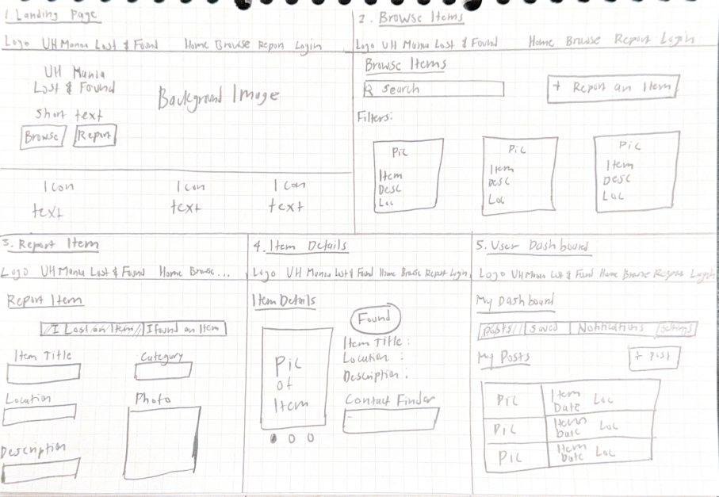

# UH Mānoa Lost & Found

### A centralized lost and found website for the UH Mānoa community

## Overview

UH Mānoa Lost & Found is a web application designed to help students and staff find lost items around campus. Currently, lost items are reported through different offices, social media pages, and group chats, making it difficult for people to find their belongings.

Our goal is to create one website where users can report lost or found items, search through existing posts, and connect with others to recover their belongings.

## Features

Our application will include:

- **Lost and Found Posts:** Users can post items with pictures, descriptions, categories, and locations.
- **Search and Filtering:** Users can search for items based on category, description, or location.
- **User Accounts:** Users can sign in, manage their posts, and save possible matches.
- **Automatic Matching:** The system can suggest potential matches between lost and found items.
- **Notifications:** Users can receive notifications when a possible match is found.
- **Item Verification:** Finders can ask verification questions before returning an item. After successful verification, the system can provide a redemption code for pickup.

## Planned Pages

We plan to develop the following pages:

1. **Landing Page:** Introduces the application and provides login options.
2. **Browse Items Page:** Displays lost and found items with search and filtering.
3. **Report Item Page:** Allows users to submit lost or found item reports.
4. **Item Details Page:** Displays information about a specific item.
5. **User Dashboard:** Allows users to manage their posts and saved matches.

## Mockups

Below are our initial hand-drawn mockups for the UH Mānoa Lost & Found application.

## Development Tools

- Next.js
- React
- Bootstrap 5
- TypeScript
- GitHub
- Vercel

## Team Members

| | Name | GitHub |
|:-:|---|---|
|  | Riki Sanehira | [rikisane](https://github.com/rikisane) |
|  | Sammie Lin | [linsammi](https://github.com/linsammi) |
|  | Ethan Kirkham | [ethankirkham04](https://github.com/ethankirkham04) |
|  | Jeremy Molina | [JZu808](https://github.com/JZu808) |

## Project Links

- [GitHub Organization](https://github.com/UHM-LaF)
- [Application Repository](https://github.com/UHM-LaF/lost-and-found)
- [Website Repository](https://github.com/UHM-LaF/uhm-laf.github.io)

## Development Progress

### Milestone 1 (M1)

Our first milestone focuses on developing the landing page, creating mockups for the main application pages, and deploying the initial version of the application.

Additional screenshots, deployment links, and project board information will be added as development continues.
